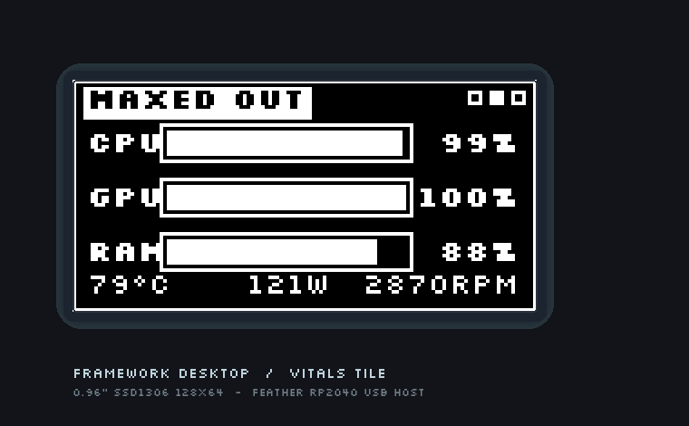

# Framework Desktop Tiles

Experiments with the magnetic front tiles of the Framework Desktop: electronics,
firmware and the docs behind them.

## Vitals tile

A 0.96" OLED tile that shows how hard the machine is working — CPU / GPU / RAM
bars, a plain-language verdict (`IDLE` … `MAXED OUT`), plus temperature, package
watts and fan RPM. Built to explain local AI to people who have never watched a
CPU meter.



Runs on an Adafruit Feather RP2040 USB Host with an SSD1306 128x64 I2C panel.
The PC renders each 1-bit frame and streams it over USB; the Pico just drives the
display over I2C.

```bash
git clone https://github.com/sezabart/framework-tiles.git
cd framework-tiles/vitals-tile
./run.sh                        # live vitals, reconnects on its own
./run.sh --simulate             # fake AI workload
./scripts/install-autostart.sh  # start at login (systemd user service)
```

See [`vitals-tile/README.md`](vitals-tile/README.md) for wiring, flashing and the
serial protocol.

## Layout

```text
docs/            expansion card / tile design notes
vitals-tile/     host renderer + RP2040 firmware + previews
```

## CAD

The 3D model of the 0.96" display (`display-oled-*-snapshot.*`) is a vendor
download and is intentionally not tracked here; the `*.wrl` mesh and the snapshot
`.zip` stay local.
