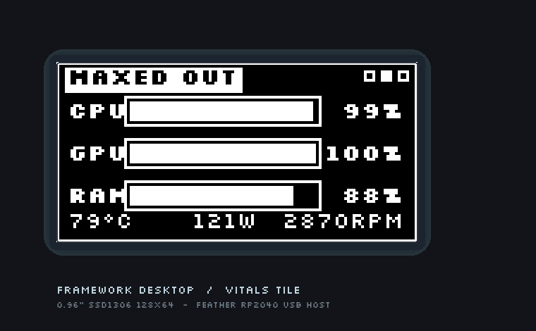
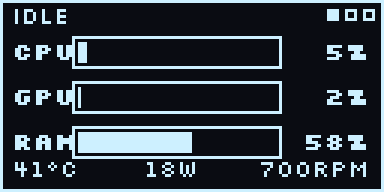

# Framework Desktop Vitals Tile

A 0.96" OLED that shows how hard the PC is working — built for explaining local AI
to people who have never watched a CPU meter before.



Three bars (CPU / GPU / RAM), a plain-language verdict at the top, and temperature,
package watts and fan RPM along the bottom. When the busiest part passes 90% the
header flips to an inverted **MAXED OUT**.

Runs on an **Adafruit Feather RP2040 USB Host** with an **SSD1306 128x64 I2C OLED**
(the same panel that will sit in the 3D-printed front tile). The PC renders each
frame and pushes it over USB; the Pico just talks I2C to the panel.

---

## Quick start

The board is already flashed with CircuitPython + this firmware, so:

```bash
./run.sh                 # live vitals from this machine
./run.sh --simulate      # fake local-AI workload, nice for demoing anywhere
./run.sh --gif preview/demo.gif   # render the animation without hardware
```

`run.sh` creates a virtualenv and installs `pyserial` + `Pillow` on first run.
Stop with `Ctrl-C`.



## Hardware

| Part | Notes |
| :--- | :--- |
| Adafruit Feather RP2040 USB Host | CircuitPython 10.3.2, board ID `adafruit_feather_rp2040_usb_host` |
| 0.96" SSD1306 OLED, 128x64, I2C | Address `0x3C` (0x3D also works) |
| STEMMA QT / Qwiic cable | Or four jumper wires |

Wiring (the Feather's STEMMA QT connector is the same bus):

| OLED | Feather |
| :--- | :--- |
| `GND` | `GND` |
| `VCC` | `3V` |
| `SDA` | `SDA` (GPIO2) |
| `SCL` | `SCL` (GPIO3) |

The firmware scans the bus at boot and prints the result on the console. If no
panel answers it blinks the red LED instead of pretending to work.

## Flashing a fresh board

1. Download CircuitPython for the board:
   [adafruit_feather_rp2040_usb_host](https://circuitpython.org/board/adafruit_feather_rp2040_usb_host/)
   (tested with 10.3.2).
2. Double-tap **RESET**; the `RPI-RP2` drive appears, copy the `.uf2` onto it.
3. Wait for the `CIRCUITPY` drive, then copy the contents of [`firmware/`](firmware):
   `boot.py`, `code.py`, `splash.bin`.
4. The board reboots with two serial ports: the console and a binary **data**
   channel. `./run.sh` finds the data one automatically.

No CircuitPython libraries are needed — the firmware drives the SSD1306 directly,
so there is no `lib/` folder to manage.

## Usage

```
./run.sh [--port /dev/ttyACM1] [--fps 2] [--simulate] [--png out.png]
         [--gif out.gif] [--seconds 10] [--scale 4] [--quiet]
```

| Flag | Meaning |
| :--- | :--- |
| `--simulate` | send a scripted 10 s AI workload instead of real sensors |
| `--png PATH` | save one frame of *real* data as an upscaled PNG, no board needed |
| `--gif PATH` | save the scripted animation, no board needed |
| `--port` | override auto-detection |
| `--fps` | frame rate, default 2 (USB is fast; 2 is plenty for gauges) |

## How it works

```text
Framework Desktop                         Feather RP2040 USB Host
┌──────────────────────────┐   USB CDC   ┌────────────────────────┐   I2C 400 kHz   ┌──────────┐
│ vitals.py  (/proc, /sys) │  data port  │ code.py                │ ──────────────> │ SSD1306  │
│ render.py  (PIL, 1-bit)  │ ──────────> │ 8 page writes/frame    │                 │ 128x64   │
│ oled_vitals.py (2 fps)   │  1026 B/fr  │ splash when host gone  │                 │          │
└──────────────────────────┘             └────────────────────────┘                 └──────────┘
```

* The PC renders a 128x64 **1-bit** image with a pixel font (Silkscreen, OFL), so
  the panel looks identical to the previews — no font rendering on the Pico.
* Wire format: `0xA5 0x5A` + 1024 bytes, SSD1306 page format. An ASCII `VIT?\n`
  handshake identifies the data port and confirms the tile is alive; `STAT?\n`
  returns the number of frames drawn.
* Pixels are converted from row-major/ MSB-first (PIL) to the SSD1306's
  column-major/ LSB-first page layout in [`host/render.py`](host/render.py).
* After 4 s without frames the tile redraws its **WAITING FOR HOST** splash
  (`firmware/splash.bin`, generated by [`host/make_splash.py`](host/make_splash.py)).

### What the verdict means

| Busiest of CPU/GPU | Header |
| :--- | :--- |
| `< 8%` | `IDLE` |
| `< 35%` | `LIGHT` |
| `< 65%` | `BUSY` |
| `< 90%` | `HEAVY` |
| `>= 90%` | `MAXED OUT` (inverted) |

Thresholds live in `status_word()` in [`host/render.py`](host/render.py).

## Sensors (Framework Desktop / Ryzen AI Max + 395)

| Tile | Source | Notes |
| :--- | :--- | :--- |
| CPU % | `/proc/stat` delta | all cores, smoothed |
| GPU % | `/sys/class/drm/card*/device/gpu_busy_percent` | GPU busy, includes ROCm/Vulkan compute work; cross-checked against `drm-engine-*` fdinfo counters |
| RAM % | `/proc/meminfo` `MemAvailable` | used = total − available, like GNOME |
| °C | `k10temp` `temp1_input` | package/Tctl |
| W | `amdgpu` `power1_average` | APU package power |
| RPM | `cros_ec` `fan1/fan2` | fans idle at 0 on this machine |

Every source is optional; missing ones show `--`. On other Linux machines CPU/RAM
work out of the box, GPU may not.

## Tuning

* Frame rate / smoothing: `--fps`, `alpha` in `VitalsSampler.sample()`.
* Layout: constants and coordinates in `Renderer.render()`; the font is 5x7 px at
  8 pt, the big splash font is the same family at 16 pt.
* Contrast: `0x81, 0xCF` in the firmware `INIT` sequence.
* 128x32 panels: change `HEIGHT`, `0xA8` multiplex and page count (not tested).

## Next step: the real expansion card

This demo maps directly onto the custom card from the
[expansion card design doc](../docs/expansion-card-design.md):
move SDA/SCL from GPIO2/3 to **GPIO4/5** on the dual Qwiic headers, keep the same
`code.py` (only `board.SCL`/`board.SDA` change), and the host script is unchanged.
Add the USB hub + CMSIS-DAP later; the OLED path stays a dumb I2C sink.

## Troubleshooting

| Symptom | Fix |
| :--- | :--- |
| `none answered the handshake` | Check the console (`screen /dev/ttyACM0 115200`): is `SSD1306: 0x3c` printed? |
| Red LED blinking, nothing on screen | I2C wiring / address; the console prints the scan result |
| Screen freezes on the last frame | Host stopped; it returns to the splash after 4 s |
| `/error.txt` on CIRCUITPY | Last firmware traceback (written on fatal errors) |
| Flicker or I2C errors | Lower `frequency=400_000` to `100_000` in `code.py` |
